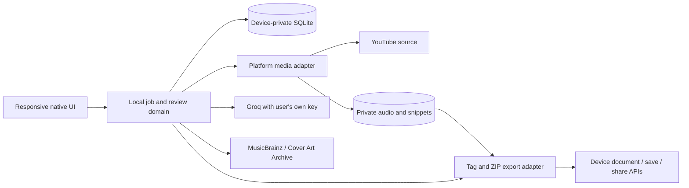

# Architecture: zero-budget independent devices

Revised 2026-10-12. Confirmed: independent Android and iPhone use, laptop support, zero budget and device-only saves. No Mac/iPhone is available for tests. The [previous hosted topology](decisions/0000-hosted-plan-superseded.md) is no longer the default.

## Proposed direction

Use the Stage 1 shared Flutter UI/domain foundation, native media adapters, private local scratch files and SQLite state. Validate extraction, codecs, metadata, file export, background work and key storage separately on each platform. No central API, hosted worker, cloud database or object-storage dependency is required.

Phones use their own network and computation; no laptop must remain online for them. Browser-only local extraction/encoding is not a demonstrated substitute. The native app can open without our hosted service, but new downloads/AI/artwork still need internet and may fail upstream.

## Platform proof

| Platform | Candidate | Status |
| --- | --- | --- |
| Laptop | yt-dlp + EJS/Deno + FFmpeg/ffprobe + ID3/ZIP adapter | Linux CLI core and Flutter foundation verified; Windows builds pending; app packaging untested |
| Android | Current yt-dlp/native audio wrapper through platform channels | Candidate only; native ABI/Python/JS-runtime/SDK compatibility must be tested |
| iPhone | iOS-compatible extraction and in-process native codec/tag/export adapters | No verified adapter/build/device; no Mac/iPhone access |

The subprocess-based desktop harness cannot simply be copied into iOS. Do not assume an embedded Python runtime provides desktop process facilities. Inspect maintained runtime/codec options before adopting an old tutorial. The historical FFmpegKit package is retired; its upstream points to FFmpegKitNext and maintained alternatives.

Primary references: [Android wrapper](https://github.com/yausername/youtubedl-android), [FFmpegKit status](https://github.com/arthenica/ffmpeg-kit), [Flutter iOS setup](https://docs.flutter.dev/platform-integration/ios/setup). Native library versions, size and component license compatibility remain spike/release checks. Public App Store distribution normally requires paid Apple Developer Program membership; development testing has a different route. A zero-budget public iOS release is unresolved. [Apple enrollment](https://developer.apple.com/programs/enroll/)

## Local records and invariants

Use immutable IDs independent of titles. Proposed SQLite records: jobs (phase/revision/deadlines/counts), playlist entries (original positions/video identities), tracks (separate original/suggested/effective metadata and overrides), assets (private paths/checksums/bytes), attempts (checkpoints/generation/retries/errors) and exports (frozen selection/revision/complete manifest).

Use transactions, generation/fencing checks and atomic publication. Stale attempts cannot overwrite new state. OS suspension is expected: checkpoint and resume when permitted, rather than promising unlimited background execution. Do not introduce Postgres/Redis as mandatory infrastructure.

## Credentials and providers

The local CLI loads only this project's .env, never parent directories or DOT.'s file; existing environment variables take priority. .env has a blank GROQ_API_KEY and GROQ_MODEL=openai/gpt-oss-120b. Never commit it, print values or embed it in release binaries.

A compiled client cannot protect one shared developer key through obfuscation. Each user enters their own key, stored through OS secure storage. Send bounded source text only, not audio, private URLs or cookies. The selected model supports strict structured output and is listed in Groq's free-plan limits; validate the user's actual account and song-identification quality before relying on it. [Structured outputs](https://console.groq.com/docs/structured-outputs), [rate limits](https://console.groq.com/docs/rate-limits)

Artwork uses identifying User-Agent, per-device throttling/cache, trusted-provider adapters and conservative recording/release matching. A matching title alone is insufficient. Preserve version/artist evidence and provenance; reject unknown covers rather than assigning a guess. No arbitrary model-generated fetch URL.

## Metadata and tags

Required structured fields: track_id, title, artists[], featured_artists[], nullable album/version, needs_review and nullable reason. Unknowns use empty arrays/null. Validate exact ID sets, uniqueness, fields and bounds in addition to provider schema compliance.

Render song name - artist - features, omitting empty features. Preserve remix/live/slowed/verse-only markers in semantic titles and embedded tags. Human fields/revisions take precedence over provider suggestions. File identity stays constant during edits.

Initial ID3 mapping: TIT2 semantic title/version; TPE1 primary artists; TALB only when known; nonempty TXXX:FEATURED_ARTISTS; TXXX:SOURCE_VIDEO_ID; WOAS source URL; APIC validated front cover. Target ID3v2.3 compatibility, read fields/image bytes back and check local-player behavior. Some players ignore custom feature fields, so filenames also carry features.

## Processing and device export

Acquire → convert once → snippet → enrich → review. Download a unique video once per job while retaining occurrence positions. Source failures remain visible; AI/artwork failures retain playable media and review warnings.

Save freezes ready selections and metadata revision. Produce new full-length tagged derivatives, validate duration/decoding/tags/cover, allocate casefold/Unicode collision-safe portable names, build/verify ZIP and checksums, then publish a complete private export. Repeated Save reuses that snapshot. Native document APIs copy/share to the chosen destination; picker cancellation or permission failure must preserve recovery and avoid false success.

Isolate files per job; cap bytes/count/duration/concurrency/retries; handle low storage and network loss. Cancel prevents stale commits. Cleanup removes unreferenced private temporary assets, never the user's exported external copies. Local job drafts/settings are not a permanent music-library feature; no account/cloud sync is required.

## Current code and scope

stage0/core.py implements contracts, bounded commands, tags and ZIP verification; providers.py contains explicit live AI/artwork and optional future hosted-storage probes; __main__.py runs checks and reports; tests/test_stage0.py verifies contracts and actual synthetic media. The Docker recipe is an optional CLI container, not the app architecture.

apps/native contains the Stage 1 Flutter foundation with actual SQLite/secure-storage adapters, private job folders, restart recovery, revision-safe metadata and immutable export snapshots. Native media capability remains unavailable. See STAGE1_GUIDE.md and decision 0002 for boundaries. Stage 0 remains in progress until actual target-platform proofs and provider/device checks pass. See IMPLEMENTATION_PLAN.md and PROJECT_STATUS.md.

The Stage 0/1 review added SQLite migration v3 for original structured metadata; legacy originals remain unknown rather than being inferred from edited fields. Cancellation, recovery and export reuse now fence stale work explicitly. See [review findings and verification](CODE_REVIEW_STAGE01.md).
